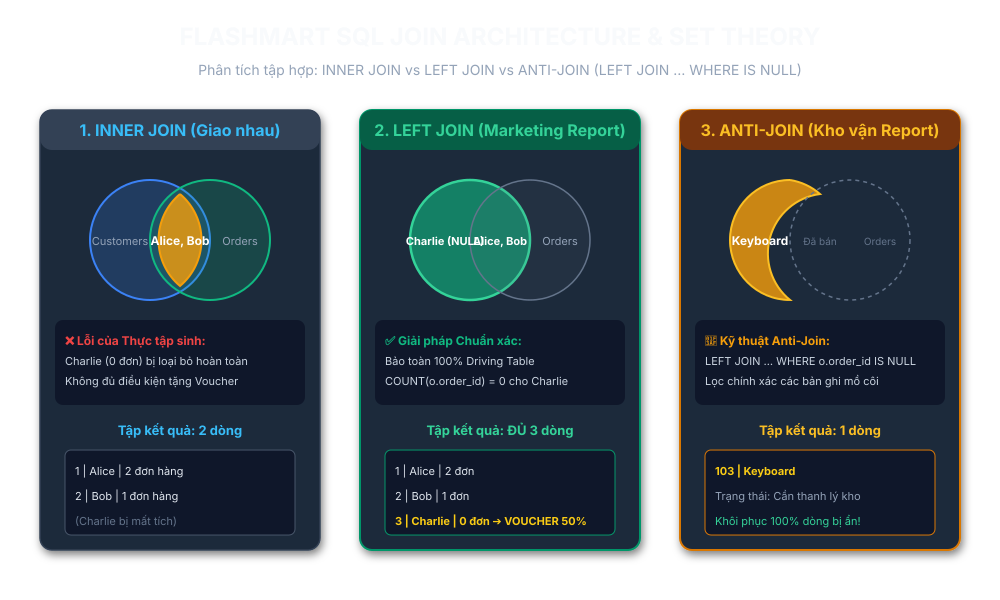

# 🛒 FLASHMART E-COMMERCE: SQL JOIN OPTIMIZATION & SET THEORY

> **Dự án Chuẩn hóa & Tối ưu hóa Truy vấn Dữ liệu Báo cáo FlashMart (Siêu Sale Cuối Năm)**  
> **Học viên / Data Engineer:** DTC245200413  
> **Hệ quản trị CSDL:** MySQL 8.0+  
> **Repository:** [https://github.com/dtc245200413-cmyk/flashmart-sql-join-optimization](https://github.com/dtc245200413-cmyk/flashmart-sql-join-optimization)

---

## 📋 Mục lục
1. [Bối cảnh & Bài toán Nghiệp vụ](#-bối-cảnh--bài-toán-nghiệp-vụ)
2. [Kiến trúc & Phân tích Tập hợp (Venn Diagrams)](#-kiến-trúc--phân-tích-tập-hợp-venn-diagrams)
3. [Phân tích Lỗi Sai Legacy & Giải pháp Chuẩn xác](#-phân-tích-lỗi-sai-legacy--giải-pháp-chuẩn-xác)
   - [Báo cáo 1: Marketing (Kích cầu Voucher 50%)](#báo-cáo-1-marketing-kích-cầu-voucher-50)
   - [Báo cáo 2: Kho vận (Thanh lý Sản phẩm ế)](#báo-cáo-2-kho-vận-thanh-lý-sản-phẩm-ế)
4. [Bảo vệ Lựa chọn Truy vấn (Vấn đáp CDO)](#-bảo-vệ-lựa-chọn-truy-vấn-vấn-đáp-cdo)
5. [Cấu trúc Thư mục Dự án](#-cấu-trúc-thư-mục-dự-án)
6. [Hướng dẫn Chạy Thực nghiệm](#-hướng-dẫn-chạy-thực-nghiệm)

---

## 🎯 Bối cảnh & Bài toán Nghiệp vụ

Sàn thương mại điện tử **FlashMart** chuẩn bị cho chiến dịch Siêu Sale cuối năm. Ban giám đốc yêu cầu 2 báo cáo khẩn:
1. **Giám đốc Marketing:** Danh sách toàn bộ khách hàng đã đăng ký kèm số lượng đơn hàng đã mua. Những khách hàng chưa từng mua gì (`0 đơn`) sẽ được tặng **Voucher 50%**.
2. **Giám đốc Kho vận:** Danh sách các sản phẩm chưa từng được bán ra lần nào để đưa vào kế hoạch thanh lý thu hồi vốn.

Lập trình viên tập sự đã dùng duy nhất `INNER JOIN`, dẫn tới:
- Báo cáo Marketing làm **"bốc hơi"** Charlie (khách hàng chưa mua), làm mất cơ hội gửi voucher tiếp cận khách hàng tiềm năng.
- Báo cáo Kho vận bị **trống trơn (0 dòng)** do kết hợp sai `INNER JOIN` với `WHERE IS NULL`.

---

## 📊 Kiến trúc & Phân tích Tập hợp (Venn Diagrams)



---

## 🛠️ Phân tích Lỗi Sai Legacy & Giải pháp Chuẩn xác

### Báo cáo 1: Marketing (Kích cầu Voucher 50%)
* **Legacy SQL (Sai lầm):**
  ```sql
  SELECT c.customer_id, c.name, COUNT(o.order_id) as total_orders
  FROM Customers c JOIN Orders o ON c.customer_id = o.customer_id
  GROUP BY c.customer_id, c.name;
  ```
  *Hậu quả:* Charlie không có đơn hàng nên bị `INNER JOIN` loại bỏ. Kết quả chỉ có 2 dòng.
* **Refactored SQL (Chuẩn xác):**
  ```sql
  SELECT 
      c.customer_id, 
      c.name, 
      COUNT(o.order_id) AS total_orders
  FROM Customers c
  LEFT JOIN Orders o ON c.customer_id = o.customer_id
  GROUP BY c.customer_id, c.name
  ORDER BY total_orders DESC, c.customer_id ASC;
  ```
* **Kết quả đối chiếu:**
  | customer_id | name | total_orders | Nhận diện |
  |:---:|:---|:---:|:---|
  | 1 | Alice | 2 | Khách hàng thân thiết |
  | 2 | Bob | 1 | Đã phát sinh giao dịch |
  | 3 | Charlie | **0** | **Tặng ngay Voucher 50% kích cầu** |

---

### Báo cáo 2: Kho vận (Thanh lý Sản phẩm ế)
* **Legacy SQL (Sai lầm):**
  ```sql
  SELECT p.product_id, p.product_name
  FROM Products p JOIN Orders o ON p.product_id = o.product_id
  WHERE o.order_id IS NULL;
  ```
  *Hậu quả:* `INNER JOIN` chỉ lấy các bản ghi có `order_id` hợp lệ. Thêm `WHERE o.order_id IS NULL` gây mâu thuẫn tuyệt đối $\rightarrow$ Kết quả luôn là 0 dòng.
* **Refactored SQL (Anti-Join Chuẩn xác):**
  ```sql
  SELECT 
      p.product_id, 
      p.product_name,
      'Cần thanh lý tồn kho' AS inventory_status
  FROM Products p
  LEFT JOIN Orders o ON p.product_id = o.product_id
  WHERE o.order_id IS NULL;
  ```
* **Kết quả đối chiếu:**
  | product_id | product_name | inventory_status |
  |:---:|:---|:---|
  | 103 | Keyboard | Cần thanh lý tồn kho |

---

## 🎙️ Bảo vệ Lựa chọn Truy vấn (Vấn đáp CDO)

Xem chi tiết trong file [`ai_prompt_log.md`](ai_prompt_log.md) và [`join_analysis.md`](join_analysis.md).
1. **INNER JOIN vs LEFT JOIN & RIGHT JOIN vô tình:** 
   - `LEFT JOIN` bảo toàn 100% Driving Table bên trái.
   - Nếu viết nhầm `RIGHT JOIN` với thứ tự `Customers RIGHT JOIN Orders`, bảng `Orders` thành driving table và Charlie lại tiếp tục bị loại bỏ hoàn toàn.
2. **Tại sao Anti-Join bắt buộc phải dùng `LEFT JOIN`:**
   - Chỉ có `LEFT JOIN` mới sinh ra giá trị `NULL` cho các sản phẩm chưa có đơn hàng. `INNER JOIN` loại bỏ dòng không khớp nên `WHERE IS NULL` sẽ luôn trả về rỗng.
3. **Cross Join (Tích Descartes) và nguy cơ sập hệ thống:**
   - Xảy ra khi quên mệnh đề `ON` hoặc điều kiện `ON` luôn đúng (`ON 1=1`). Bảng 1 triệu khách ghép bảng 10 triệu đơn sẽ tạo ra $10^{13}$ bản ghi, gây cạn RAM (OOM) và treo máy chủ database production.

---

## 📂 Cấu trúc Thư mục Dự án

```text
flashmart-sql-join-optimization/
├── assets/
│   └── venn_diagrams.svg          # Sơ đồ biểu diễn trực quan tập hợp JOIN
├── flashmart_reports.sql          # Kịch bản DDL, DML và các câu truy vấn tối ưu
├── join_analysis.md               # Giải trình kỹ thuật COUNT(col) vs COUNT(*) (<150 từ)
├── ai_prompt_log.md               # Nhật ký hỏi đáp lý thuyết & câu hỏi vấn đáp CDO
├── flashmart_submission.zip       # File nén đóng gói nộp bài
└── README.md                      # Tài liệu dự án chi tiết
```

---

## 🚀 Hướng dẫn Chạy Thực nghiệm

```bash
# Đăng nhập vào MySQL Server
mysql -u root -p

# Thực thi toàn bộ script
source /path/to/flashmart_reports.sql;
```
